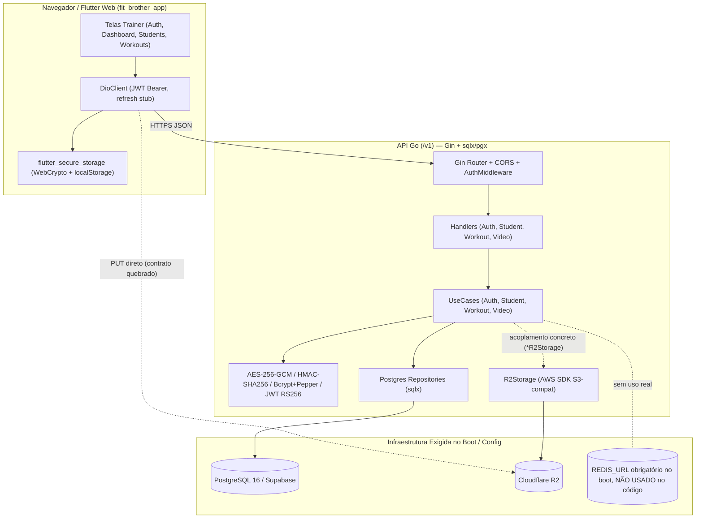

# Estado Atual do Sistema (AS-IS)

Este documento descreve a arquitetura e o comportamento reais do Fit Brother na branch `develop` (`16a8e69`), baseados exclusivamente na inspeção do código-fonte.

---

## 1. Visão Geral do Estado Atual

O sistema é composto por um **monólito modular Go (Gin + sqlx/pgx)** e um **cliente Flutter (`fit_brother_app`)**, estruturados em um único repositório Git:
- O backend implementa os fluxos iniciais de autenticação JWT RS256, cadastro/consulta/anonimização de alunos (com CPF criptografado), criação/leitura de planos de treino e geração de URLs assinadas no Cloudflare R2.
- O frontend cobre apenas parte da jornada do Personal Trainer (login, dashboard simples, cadastro de aluno e criação básica de planos/sessões/exercícios), com falhas de integração no upload de vídeos, ausência de refresh automático de sessão e **nenhuma tela funcional para o perfil Aluno**.

---

## 2. Diagrama da Arquitetura Atual (AS-IS)

---

## 3. Achados Críticos do Funcionamento Atual

1. **Cadastro de aluno aberto ao público (`POST /v1/students`):** O handler registra `group.POST("", h.Create)` sem `RequireAuth` (`student_handler.go:37`).
2. **Isolamento quebrado entre treinadores e alunos:** A tabela `students` não tem coluna `trainer_id` nem tabela de vínculo. Qualquer treinador lista, lê CPF descriptografado ou anonimiza qualquer aluno (`student_handler.go:65-138`); qualquer aluno autenticado consegue listar todos os alunos do sistema (`GET /v1/students`).
3. **Bug bloqueante na listagem/leitura de treinos para Aluno:** `workout_plans.student_id` aponta para `students(id)`, mas `WorkoutHandler.ListPlans` e `GetPlanDetailsUseCase` comparam `student_id` diretamente contra `claims.UserID` (`users.id`). Como `students.id != users.id`, alunos sempre recebem lista vazia ou `"acesso negado"` nos próprios treinos (`workout_handler.go:110`, `workout/usecases.go:196`).
4. **Exposição de URLs assinadas e upload sem validação:** `GetSignedURL` (`video_handler.go:92-113`) não verifica ownership ou vínculo com o exercício; `ConfirmUpload` confia integralmente nos metadados enviados pelo cliente sem `HeadObject` no R2 (`video/usecases.go:75-97`).
5. **Startup acoplado a variáveis não utilizadas/opcionais:** `config.go:77,93-97` chama `requireEnv` para `REDIS_URL` e todas as 5 variáveis `R2_*`, impedindo a API de iniciar sem Redis (mesmo não havendo código Redis) ou sem bucket R2.
6. **Inconsistência de contrato de vídeos no Flutter:** O app chama endpoints e formatos JSON inexistentes no backend (`POST /videos/request-upload` e `POST /videos/confirm`).
7. **Fluxo de logout e refresh quebrados no Flutter:** Logout do Flutter não envia `refresh_token` no corpo (`auth_provider.dart:71`), e o interceptor `401` do `DioClient` contém apenas um comentário stub (`dio_client.dart:32-34`).

---

## 4. Referências Cruzadas

- Lista detalhada de funcionalidades: [`feature-inventory.md`](feature-inventory.md)
- Auditoria de segurança completa: [`../03-security/security-audit.md`](../03-security/security-audit.md)
- Modelagem AS-IS: [`../02-architecture/data-model-current.md`](../02-architecture/data-model-current.md)
- Dívida técnica: [`technical-debt.md`](technical-debt.md)
