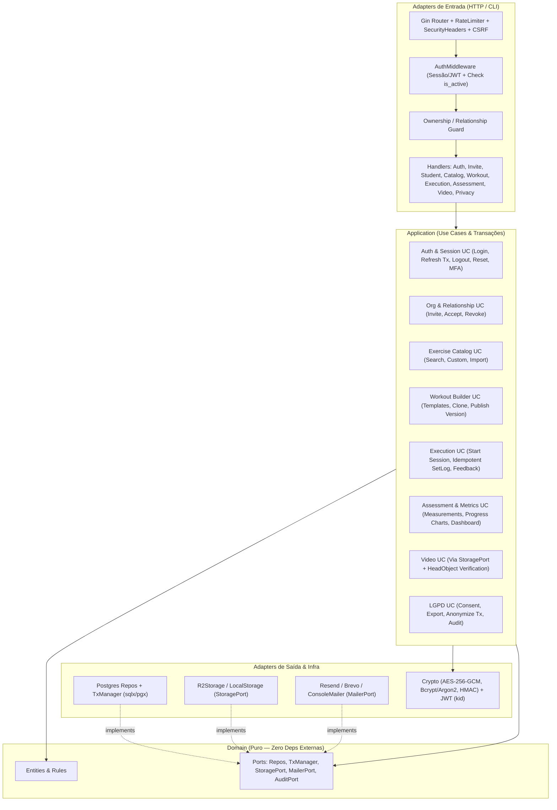
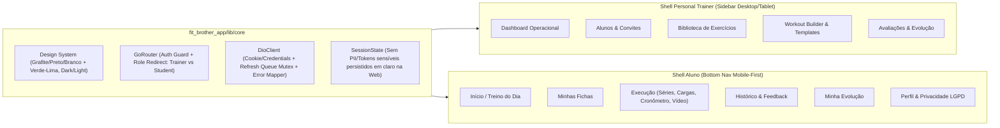

# Diagramas de Componentes (C4 Nível 3 — Backend Go e Frontend Flutter)

## 1. Backend Go — Arquitetura Hexagonal Alvo

### Correção Explícita Frente ao Estado Atual
- Hoje `internal/application/video/usecases.go` referencia `*storage.R2Storage` diretamente. Na Fase 2, `video/usecases.go` passa a depender exclusivamente de `domain.StoragePort`, permitindo mock em testes, storage local em desenvolvimento offline e R2/Supabase em nuvem.

---

## 2. Frontend Flutter — Organização Modular Alvo

