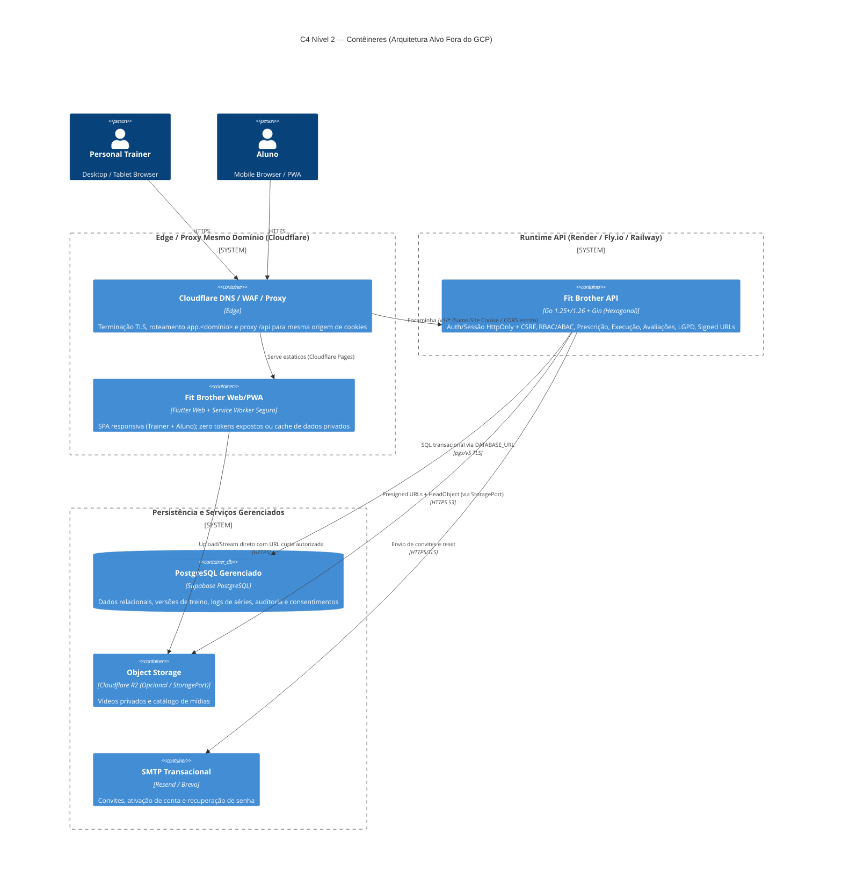

# Diagrama de Contêineres (C4 Nível 2 — TO-BE)

### Notas Arquiteturais Importantes
1. **Roteamento Same-Site (`/v1/*` ou subdomínio sob mesmo eTLD+1):** Essencial para usar cookies `HttpOnly; Secure; SameSite=Lax` sem sofrer bloqueios de cookies third-party (especialmente Safari/iOS ITP) e sem obrigar um segundo servidor Node separado apenas para BFF — o proxy/CDN encaminha `/v1/*` para a API Go ou o próprio subdomínio compartilhado usa `SameSite=Lax` + CSRF token.
2. **Service Worker:** Configurado para fazer cache apenas de shell estático/fontes/assets públicos da UI, **nunca** interceptando/armazenando respostas de `/v1/*` ou URLs assinadas de vídeos.
3. **Sem Redis por padrão:** Rate limit e revogação de refresh tokens operam em memória (por instância) + PostgreSQL, mantendo apenas 1 serviço backend stateless para rodar dentro do free-tier.
