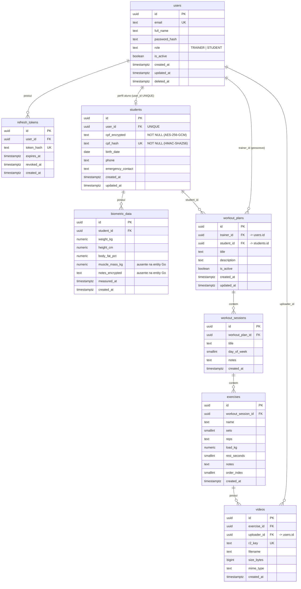

# Modelagem Atual de Dados (AS-IS)

Schema extraído integralmente das migrations `001` a `005` em `migrations/`.

---

## 1. Diagrama Entidade-Relacionamento Atual (DER AS-IS)

---

## 2. Problemas Identificados nas Migrations Atuais

1. **Ausência de relacionamento Trainer ↔ Student:** `students` não referencia `trainer_id` nem há tabela de vínculo; qualquer trainer acessa qualquer aluno.
2. **Inconsistência `users.id` vs `students.id`:** `workout_plans.student_id` aponta para `students.id`, mas o código atual (`workout_handler.go` e `workout/usecases.go`) passa `claims.UserID` (`users.id`).
3. **CPF obrigatório (`NOT NULL`) em `students`:** Contraria a minimização da LGPD para gestão de treinos e cria superfície crítica de exposição (`cpf_encrypted` retornada por `GET /students/:id`).
4. **Tabela `biometric_data` ociosa e dessincronizada:** As colunas `muscle_mass_kg` e `notes_encrypted` existem no SQL (`003_create_students_and_biometrics.up.sql`), mas não constam em `domain/student/entity.go`, nem há repositórios/endpoints.
5. **Ausência de catálogo e execução:** `exercises` mistura definição do exercício (`name`), prescrição (`sets`, `reps`, `load_kg`) e não possui histórico de execução pelo aluno nem versionamento de fichas.
6. **Risco no `migrate down`:** `scripts/migrate.go down` executa rollback total de todas as tabelas (`DROP TABLE`), incompatível com ambientes persistentes.
