# Modelagem Proposta de Dados (TO-BE)

Todas as evoluções devem ser aplicadas como **migrations incrementais (`006+`)** sem editar as migrations históricas (`001`–`005`).

---

## 1. Diagrama Entidade-Relacionamento Alvo (DER TO-BE)

```mermaid
erDiagram
    organizations ||--o{ memberships : "possui"
    users ||--o{ memberships : "participa"
    organizations ||--o{ trainer_student_relationships : "escopo"
    users ||--o{ trainer_student_relationships : "trainer_user_id"
    students ||--o{ trainer_student_relationships : "student_id"
    organizations ||--o{ invitations : "emite"
    users ||--o| students : "perfil"

    exercise_catalog ||--o{ exercise_media : "mídias"
    organizations ||--o{ exercise_catalog : "custom (null=global)"
    organizations ||--o{ workout_templates : "biblioteca"
    workout_templates ||--o{ workout_versions : "snapshots imutáveis"
    workout_versions ||--o{ workout_assignments : "publicado em"
    students ||--o{ workout_assignments : "recebe"
    workout_assignments ||--o{ executed_workout_sessions : "execuções"
    executed_workout_sessions ||--o{ set_logs : "séries"
    executed_workout_sessions ||--o{ workout_feedback : "feedback"

    students ||--o{ physical_assessments : "avaliações"
    physical_assessments ||--o{ body_measurements : "circunferências"
    students ||--o{ weight_entries : "histórico peso"

    users ||--o{ consent_records : "consentimentos"
    users ||--o{ privacy_requests : "solicitações LGPD"
    users ||--o{ audit_events : "eventos"

    organizations {
        uuid id PK
        text name
        text slug UK
        text type "SOLO | STUDIO"
        timestamptz created_at
    }
    memberships {
        uuid id PK
        uuid organization_id FK
        uuid user_id FK
        text role "OWNER | TRAINER | ADMIN"
        text status "ACTIVE | SUSPENDED"
    }
    trainer_student_relationships {
        uuid id PK
        uuid organization_id FK
        uuid trainer_user_id FK
        uuid student_id FK
        text status "ACTIVE | PAUSED | ENDED"
        timestamptz started_at
        timestamptz ended_at
    }
    invitations {
        uuid id PK
        uuid organization_id FK
        uuid trainer_user_id FK
        text email
        text token_hash UK
        text status "PENDING | ACCEPTED | EXPIRED | REVOKED"
        timestamptz expires_at
        timestamptz accepted_at
    }
    exercise_catalog {
        uuid id PK
        uuid organization_id FK "NULL = catálogo global"
        text external_source "free-exercise-db | custom"
        text external_id
        text name_pt
        text name_en
        text primary_muscle
        text equipment
        text category
        text instructions_pt
        text license_info
    }
    exercise_media {
        uuid id PK
        uuid exercise_id FK
        uuid organization_id FK
        text storage_key
        text media_type "VIDEO | IMAGE | GIF"
        text status "PENDING | CONFIRMED"
        bigint size_bytes
    }
    workout_templates {
        uuid id PK
        uuid organization_id FK
        uuid trainer_user_id FK
        text title
        text goal
        boolean is_archived
    }
    workout_versions {
        uuid id PK
        uuid template_id FK
        int version_number
        jsonb snapshot_structure "dias e exercícios prescritos imutáveis"
        timestamptz published_at
    }
    workout_assignments {
        uuid id PK
        uuid organization_id FK
        uuid workout_version_id FK
        uuid student_id FK
        uuid trainer_user_id FK
        date valid_from
        date valid_until
        text status "ACTIVE | ARCHIVED"
    }
    executed_workout_sessions {
        uuid id PK
        uuid assignment_id FK
        uuid student_id FK
        text client_idempotency_key UK "evita duplicidade offline"
        int day_index
        timestamptz started_at
        timestamptz finished_at
        smallint rpe
    }
    set_logs {
        uuid id PK
        uuid executed_session_id FK
        uuid catalog_exercise_id FK
        smallint set_number
        smallint reps_done
        numeric load_kg
        boolean completed
    }
    physical_assessments {
        uuid id PK
        uuid organization_id FK
        uuid student_id FK
        uuid assessor_user_id FK
        date assessed_on
        text method
        numeric weight_kg
        numeric height_cm
        numeric body_fat_pct
        numeric lean_mass_kg
        text notes_encrypted
    }
    body_measurements {
        uuid id PK
        uuid assessment_id FK
        text site "chest | waist | hip | arm_r ..."
        numeric value_cm
    }
    weight_entries {
        uuid id PK
        uuid student_id FK
        numeric weight_kg
        timestamptz recorded_at
    }
    workout_feedback {
        uuid id PK
        uuid executed_session_id FK
        uuid student_id FK
        smallint difficulty_rating
        text comment
        timestamptz created_at
    }
    consent_records {
        uuid id PK
        uuid user_id FK
        text purpose "HEALTH_DATA | MEDIA_UPLOAD | TERMS"
        text policy_version
        boolean granted
        timestamptz recorded_at
    }
    privacy_requests {
        uuid id PK
        uuid user_id FK
        text request_type "EXPORT | ANONYMIZE | RECTIFY"
        text status "OPEN | COMPLETED | REJECTED"
        timestamptz requested_at
        timestamptz completed_at
    }
    audit_events {
        uuid id PK
        uuid actor_user_id FK
        uuid organization_id FK
        text action
        text target_type
        uuid target_id
        timestamptz created_at
    }
```

---

## 2. Estratégia Incremental de Evolução (Resumo)

1. **Migration `006` (Fase 1):** Adicionar `trainer_id` em `students` (backfill seguro em dev/staging para trainer principal se existir apenas 1), índices em `workout_plans(trainer_id, student_id)` e preparar transição de vínculo.
2. **Migrations `007`–`008` (Fase 3):** Criar `organizations`, `memberships`, `trainer_student_relationships`, `invitations`, `consent_records`, `privacy_requests`, `audit_events` e tornar `students.cpf_encrypted` e `students.cpf_hash` **NULLABLE** (permitindo remoção futura total).
3. **Migration `009` (Fase 4):** Criar `exercise_catalog` (+ tabelas auxiliares normalizadas ou lookup de grupos musculares/equipamentos se necessário) e `exercise_media` (com estado `PENDING`/`CONFIRMED` para upload seguro).
4. **Migrations `010`–`012` (Fases 5–7):** Criar `workout_templates`, `workout_versions`, `workout_assignments`, `executed_workout_sessions`, `set_logs`, `workout_feedback`, `physical_assessments`, `body_measurements` e `weight_entries`.

Ver plano detalhado de compatibilidade, backfill e rollback em [`../05-infrastructure/migration-plan.md`](../05-infrastructure/migration-plan.md).
