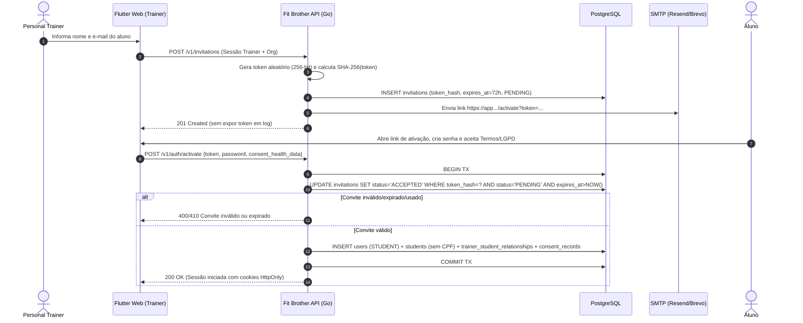
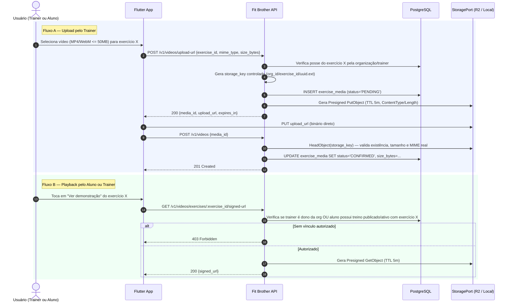
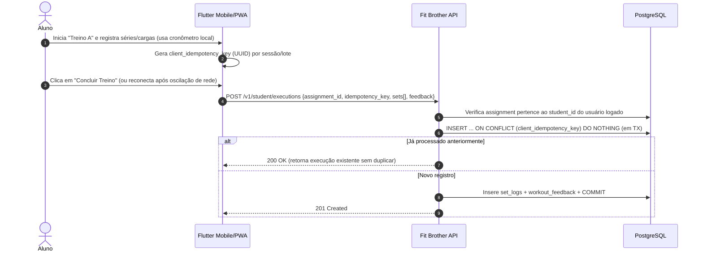

# Diagramas de Sequência e Swimlanes (Fluxos Críticos TO-BE)

## 1. Fluxo de Convite e Ativação do Aluno (Fase 3 — Sem CPF)

---

## 2. Upload e Playback Autorizado de Vídeo (Fases 1–4 — Anti-BOLA)

---

## 3. Execução de Treino pelo Aluno com Idempotência (Fase 6)

