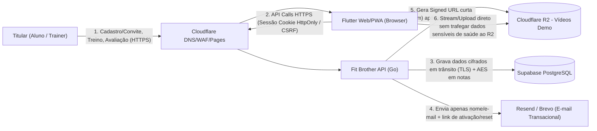

# Mapa de Fluxo de Dados Pessoais (Data Flow Map)

---

## Fronteiras e Salvaguardas por Etapa

1. **Browser (Flutter Web/PWA):** Proibido armazenar avaliações biométricas, tokens ou dados privados em cache persistente de Service Worker ou `localStorage` em claro após migração para cookies `HttpOnly` (Fase 2/8).
2. **Trânsito Internacional de Dados:** Provedores gratuitos em nuvem (Cloudflare, Render, Resend/Brevo, GitHub, e Supabase caso não alocado exclusivamente em `sa-east-1`) podem processar ou rotear dados fora do Brasil. Isso exige cláusulas de transferência internacional (Art. 33 LGPD / Resolução CD/ANPD nº 19/2024), seleção de região São Paulo (`sa-east-1`) sempre que disponível no Supabase sem custo extra e transparência explícita na Política de Privacidade.
3. **E-mail Transacional (SMTP):** Nunca incluir dados de saúde, medidas corporais, senhas ou CPF no corpo de e-mails — enviar somente nome, instrução neutra e link opaco temporário.
4. **Logs de Aplicação (`zerolog`):** Redação estrita; registrar apenas `request_id`, `user_id` (UUID), rota, status HTTP e latência.
