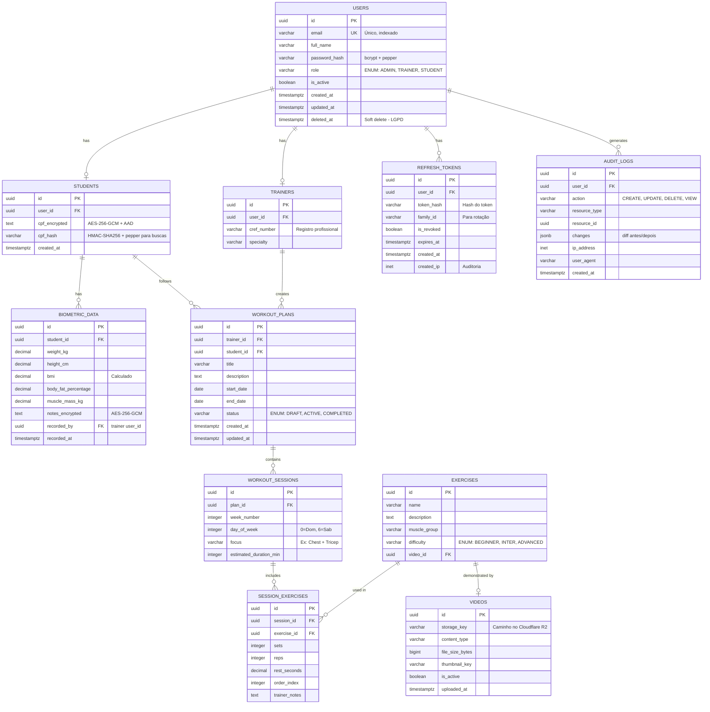

# Software Architecture Document (SAD)
## Fit Brother — Gym Management System
**Versão:** 1.1 | **Data:** 2026-04-14 | **Autor:** Senior Software Architect

> **Premissa de Infraestrutura:** Todo stack de produção usa **apenas planos gratuitos (free tier)** de serviços disponíveis publicamente. Nenhum custo para o desenvolvedor ou para o cliente.

---

## 1. Visão Geral do Sistema

O **Fit Brother** é uma plataforma de gestão de treinos composta por três camadas:

| Camada | Descrição |
|--------|-----------|
| **Backend (Go)** | API Gateway central, autenticação, lógica de negócio e persistência |
| **Painel Admin (Web)** | Interface para Personal Trainers gerenciarem alunos e cronogramas |
| **App Móvel (Flutter)** | Interface para alunos visualizarem treinos e vídeos de exercícios |

---

## 2. Stack Gratuita — Decisões de Infraestrutura

### 2.1 Serviços Free Tier Escolhidos

| Componente | Serviço Gratuito | Limite Free Tier |
|------------|-----------------|-----------------|
| **Backend Hosting** | [Railway.app](https://railway.app) | 500 horas/mês + $5 créditos grátis |
| **Banco de Dados** | [Supabase](https://supabase.com) (PostgreSQL gerenciado) | 500 MB storage, 50.000 req/mês |
| **Cache (Redis)** | [Upstash](https://upstash.com) | 10.000 comandos/dia, 256 MB |
| **Storage de Vídeos** | [Cloudflare R2](https://cloudflare.com/r2) | 10 GB storage, 1M req/mês grátis |
| **CDN** | Cloudflare Free | Ilimitado (DDoS + cache) |
| **Autenticação (JWT)** | Self-hosted no backend Go | Sem custo |
| **CI/CD** | [GitHub Actions](https://github.com/features/actions) | 2.000 min/mês grátis |
| **Painel Admin** | [Vercel](https://vercel.com) | Projetos ilimitados grátis |
| **Monitoramento** | [Grafana Cloud](https://grafana.com/products/cloud/) | 10 GB logs, 14 dias retenção |
| **App Mobile** | Flutter + GitHub (APK direto) | Gratuito |

### 2.2 Por que Cloudflare R2 para Vídeos?

- **Zero custo de egress** (diferente do AWS S3 que cobra saída de dados)
- Compatível com SDK AWS S3 — mesma API, zero mudança de código
- Signed URLs nativas — segurança mantida sem custo extra
- 10 GB gratuitos são suficientes para um MVP com dezenas de exercícios em vídeo

### 2.3 Por que Supabase para PostgreSQL?

- PostgreSQL completo (não um substituto), triggers, RLS nativo
- Dashboard visual para ver dados — útil em dev
- API REST e Realtime built-in (útil futuramente)
- Backups automáticos no plano gratuito

---

## 3. Arquitetura Geral

### 3.1 Padrão Arquitetural: Hexagonal Architecture (Ports & Adapters)

A **Arquitetura Hexagonal** foi escolhida por garantir:
- **Testabilidade total**: a lógica de negócio nunca depende de frameworks
- **Desacoplamento**: trocar banco de dados, framework HTTP ou mensageria não impacta o domínio
- **Conformidade com LGPD**: os dados sensíveis são tratados exclusivamente na camada de domínio

```
┌─────────────────────────────────────────────────────────────────────┐
│                          DRIVING SIDE                               │
│  ┌──────────┐  ┌──────────────┐  ┌─────────────────────────────┐   │
│  │ REST API │  │  gRPC API    │  │  Background Jobs (Workers)  │   │
│  └────┬─────┘  └──────┬───────┘  └──────────────┬──────────────┘   │
│       │               │                          │                  │
│  ─────┼───────────────┼──────────────────────────┼────────── PORTS  │
│       ▼               ▼                          ▼                  │
│  ┌─────────────────────────────────────────────────────────────┐    │
│  │                    APPLICATION CORE                         │    │
│  │  ┌─────────────────────────────────────────────────────┐   │    │
│  │  │                   DOMAIN LAYER                      │   │    │
│  │  │  User · Student · Workout · Exercise · BiometricData│   │    │
│  │  └─────────────────────────────────────────────────────┘   │    │
│  │  ┌──────────────────────────────────────────────────────┐  │    │
│  │  │               USE CASES / SERVICES                   │  │    │
│  │  │  Auth · StudentMgmt · WorkoutMgmt · VideoStreaming   │  │    │
│  │  └──────────────────────────────────────────────────────┘  │    │
│  └─────────────────────────────────────────────────────────────┘    │
│       │               │                          │                  │
│  ─────┼───────────────┼──────────────────────────┼────────── PORTS  │
│       ▼               ▼                          ▼                  │
│  ┌──────────┐  ┌──────────────┐  ┌─────────────────────────────┐   │
│  │ Supabase │  │   Upstash    │  │    Cloudflare R2 (vídeos)   │   │
│  │ Postgres │  │    Redis     │  │        Signed URLs           │   │
│  └──────────┘  └──────────────┘  └─────────────────────────────┘   │
│                          DRIVEN SIDE                                │
└─────────────────────────────────────────────────────────────────────┘
```

### 3.2 Estrutura de Diretórios do Backend (Go)

```
fit-brother/
├── cmd/
│   └── api/
│       └── main.go                    # Entry point
├── internal/
│   ├── domain/                        # Entidades e regras de negócio puras
│   │   ├── student/
│   │   │   ├── entity.go              # Student entity
│   │   │   ├── repository.go          # Port (interface)
│   │   │   └── service.go             # Domain service
│   │   ├── workout/
│   │   ├── exercise/
│   │   └── biometric/
│   ├── application/                   # Use Cases (orquestração)
│   │   ├── student/
│   │   │   ├── create_student.go
│   │   │   ├── update_biometric.go
│   │   │   └── dto.go
│   │   ├── workout/
│   │   └── auth/
│   ├── adapters/                      # Implementações das Ports
│   │   ├── http/                      # Driving Adapter
│   │   │   ├── handler/
│   │   │   ├── middleware/
│   │   │   └── router.go
│   │   ├── repository/                # Driven Adapter (PostgreSQL)
│   │   │   ├── postgres/
│   │   │   └── redis/
│   │   └── storage/                   # Driven Adapter (Cloudflare R2)
│   └── infrastructure/
│       ├── crypto/                    # AES-256-GCM, hashing
│       ├── jwt/
│       ├── config/
│       └── logger/
├── migrations/
├── docs/
│   └── architecture/
│       └── SAD.md                     # Este arquivo
├── docker/
│   ├── Dockerfile
│   └── docker-compose.yml             # Ambiente local de desenvolvimento
└── tests/
    ├── unit/
    ├── integration/
    └── e2e/
```

---

## 4. Diagrama de Entidade-Relacionamento (ERD)

### 4.1 Diagrama



### 4.2 Decisões de Design (Performance e Segurança)

| Decisão | Justificativa |
|---------|--------------|
| `uuid` como PK em todas as tabelas | Evita enumeração de IDs (OWASP A01), distribuído sem colisão |
| `deleted_at` (soft delete) | Conformidade com LGPD (direito ao esquecimento rastreável) |
| CPF armazenado em **duas colunas** | `cpf_encrypted` para exibição, `cpf_hash` para busca sem expor dados |
| `AUDIT_LOGS` separado | Trilha de auditoria imutável para conformidade LGPD |
| `REFRESH_TOKENS` com `family_id` | Detecção de roubo de token (Token Family Rotation) |
| Índices em `email`, `cpf_hash`, `student_id` | Evita full-table scans em operações críticas |

---

## 5. Estratégia de Criptografia e Segurança de Dados

### 5.1 CPF — Criptografia AES-256-GCM

O CPF é um dado **sensível** pela LGPD (art. 5º, I). A estratégia usa criptografia autenticada:

```go
// internal/infrastructure/crypto/aes.go

package crypto

import (
    "crypto/aes"
    "crypto/cipher"
    "crypto/rand"
    "encoding/base64"
    "errors"
    "io"
)

type AESEncryptor struct {
    key []byte // 32 bytes para AES-256 — carregado de variável de ambiente
}

func NewAESEncryptor(key []byte) (*AESEncryptor, error) {
    if len(key) != 32 {
        return nil, errors.New("chave AES deve ter exatamente 32 bytes (AES-256)")
    }
    return &AESEncryptor{key: key}, nil
}

// Encrypt usa AES-256-GCM com nonce aleatório e AAD para autenticidade.
// O AAD (Additional Authenticated Data) vincula o cifrado ao student_id,
// impedindo que um CPF cifrado seja copiado para outro registro.
func (e *AESEncryptor) Encrypt(plaintext string, aad []byte) (string, error) {
    block, err := aes.NewCipher(e.key)
    if err != nil {
        return "", err
    }

    gcm, err := cipher.NewGCM(block)
    if err != nil {
        return "", err
    }

    nonce := make([]byte, gcm.NonceSize())
    if _, err = io.ReadFull(rand.Reader, nonce); err != nil {
        return "", err
    }

    ciphertext := gcm.Seal(nonce, nonce, []byte(plaintext), aad)
    return base64.StdEncoding.EncodeToString(ciphertext), nil
}

func (e *AESEncryptor) Decrypt(encoded string, aad []byte) (string, error) {
    data, err := base64.StdEncoding.DecodeString(encoded)
    if err != nil {
        return "", err
    }

    block, err := aes.NewCipher(e.key)
    if err != nil {
        return "", err
    }

    gcm, err := cipher.NewGCM(block)
    if err != nil {
        return "", err
    }

    nonceSize := gcm.NonceSize()
    if len(data) < nonceSize {
        return "", errors.New("dados corrompidos")
    }

    nonce, ciphertext := data[:nonceSize], data[nonceSize:]
    plaintext, err := gcm.Open(nil, nonce, ciphertext, aad)
    if err != nil {
        return "", errors.New("falha na autenticação do dado cifrado")
    }

    return string(plaintext), nil
}
```

### 5.2 CPF — Hash para Busca

```go
// internal/infrastructure/crypto/hash.go

package crypto

import (
    "crypto/hmac"
    "crypto/sha256"
    "encoding/hex"
    "os"
)

// CPFHash gera um HMAC-SHA256 do CPF para permitir buscas seguras
// sem expor o dado real. O pepper vem de variável de ambiente.
func CPFHash(cpf string) string {
    pepper := []byte(os.Getenv("CPF_HMAC_SECRET"))
    mac := hmac.New(sha256.New, pepper)
    mac.Write([]byte(cpf))
    return hex.EncodeToString(mac.Sum(nil))
}
```

### 5.3 Senhas — bcrypt + Pepper

```go
// internal/infrastructure/crypto/password.go

package crypto

import (
    "golang.org/x/crypto/bcrypt"
    "os"
)

const bcryptCost = 12

func HashPassword(password string) (string, error) {
    pepper := os.Getenv("PASSWORD_PEPPER")
    pepperedPassword := password + pepper
    hash, err := bcrypt.GenerateFromPassword([]byte(pepperedPassword), bcryptCost)
    return string(hash), err
}

func CheckPassword(password, hash string) bool {
    pepper := os.Getenv("PASSWORD_PEPPER")
    pepperedPassword := password + pepper
    err := bcrypt.CompareHashAndPassword([]byte(hash), []byte(pepperedPassword))
    return err == nil
}
```

---

## 6. Autenticação — JWT com Token Family Rotation

### 6.1 Fluxo de Tokens

```
┌────────┐         ┌──────────────┐        ┌─────────────┐
│ Client │         │  Auth API    │        │  Supabase   │
└───┬────┘         └──────┬───────┘        └──────┬──────┘
    │  POST /auth/login   │                        │
    │────────────────────▶│                        │
    │                     │  Valida senha          │
    │                     │───────────────────────▶│
    │                     │◀───────────────────────│
    │  access_token (15min)│                       │
    │  refresh_token (7d) │  Persiste hash(RT)     │
    │◀────────────────────│───────────────────────▶│
    │                     │                        │
    │ POST /auth/refresh  │                        │
    │────────────────────▶│                        │
    │                     │  Valida hash(RT)       │
    │                     │  Revoga RT antigo      │
    │                     │  Emite NOVO RT         │
    │  novo access_token  │───────────────────────▶│
    │  novo refresh_token │                        │
    │◀────────────────────│                        │
    │                     │                        │
    │  [RT roubado usado] │                        │
    │────────────────────▶│                        │
    │  401 - FAMILY REVOGADA (logout forçado)      │
    │◀────────────────────│───────────────────────▶│
```

---

## 7. Definição das APIs (REST)

**Base URL:** `https://api.fitbrother.com/v1`

### Auth
| Método | Endpoint | Acesso | Descrição |
|--------|----------|--------|-----------|
| `POST` | `/auth/login` | Público | Login com email + senha |
| `POST` | `/auth/refresh` | Público | Renovação de tokens |
| `POST` | `/auth/logout` | Autenticado | Revoga refresh token |

### Students (Trainer only)
| Método | Endpoint | Acesso | Descrição |
|--------|----------|--------|-----------|
| `POST` | `/students` | TRAINER | Cadastra novo aluno |
| `GET` | `/students` | TRAINER | Lista alunos do trainer |
| `GET` | `/students/{id}` | TRAINER | Detalhes do aluno |
| `PATCH` | `/students/{id}` | TRAINER | Atualiza dados |
| `DELETE` | `/students/{id}` | TRAINER | Soft delete (LGPD) |
| `POST` | `/students/{id}/biometrics` | TRAINER | Registra biometria |
| `GET` | `/students/{id}/biometrics` | TRAINER + STUDENT_SELF | Histórico biométrico |

### Workout Plans
| Método | Endpoint | Acesso | Descrição |
|--------|----------|--------|-----------|
| `POST` | `/workout-plans` | TRAINER | Cria plano de treino |
| `GET` | `/workout-plans/{id}` | TRAINER + STUDENT_OWNER | Detalhes do plano |
| `POST` | `/workout-plans/{id}/sessions` | TRAINER | Adiciona sessão |
| `POST` | `/sessions/{id}/exercises` | TRAINER | Adiciona exercício |

### Exercises & Videos
| Método | Endpoint | Acesso | Descrição |
|--------|----------|--------|-----------|
| `GET` | `/exercises` | Autenticado | Lista exercícios |
| `GET` | `/exercises/{id}` | Autenticado | Detalhes + vídeo |
| `GET` | `/videos/{id}/signed-url` | Autenticado | URL assinada (5 min TTL) |
| `POST` | `/videos` | TRAINER | Upload de vídeo |

---

## 8. Vídeos — Signed URLs com Cloudflare R2

```
┌──────────────┐   GET /videos/{id}/signed-url    ┌─────────────┐
│  Flutter App │ ─────────────────────────────────▶│  Backend Go │
└──────────────┘                                   └──────┬──────┘
        │        ◀──── signed_url (TTL: 5 min) ────       │ sign(R2 key)
        │                                        ┌────────▼────────┐
        │  GET https://r2.fitbrother.com/...     │  Cloudflare R2  │
        └───────────────────────────────────────▶│  (free tier)    │
                                                  └─────────────────┘
```

**Cloudflare R2** é o storage escolhido por:
- **Egress gratuito** — AWS S3 cobra pela saída, R2 não
- API 100% compatível com S3 SDK (sem mudança de código)
- 10 GB + 1 milhão de requisições/mês gratuitos
- CDN Cloudflare integrada automaticamente

---

## 9. Infraestrutura de Desenvolvimento Local

```yaml
# docker/docker-compose.yml — APENAS para desenvolvimento local
version: '3.9'

services:
  api:
    build:
      context: .
      dockerfile: docker/Dockerfile
    ports:
      - "8080:8080"
    environment:
      - DATABASE_URL=${SUPABASE_DATABASE_URL}
      - REDIS_URL=${UPSTASH_REDIS_URL}
      - AES_KEY=${AES_KEY}
      - CPF_HMAC_SECRET=${CPF_HMAC_SECRET}
      - PASSWORD_PEPPER=${PASSWORD_PEPPER}
      - R2_ACCOUNT_ID=${R2_ACCOUNT_ID}
      - R2_ACCESS_KEY=${R2_ACCESS_KEY}
      - R2_SECRET_KEY=${R2_SECRET_KEY}
      - R2_BUCKET=${R2_BUCKET}

  # PostgreSQL local (replica da Supabase para dev offline)
  postgres:
    image: postgres:16-alpine
    environment:
      POSTGRES_USER: fitbrother
      POSTGRES_PASSWORD: secret
      POSTGRES_DB: fitbrother_db
    volumes:
      - postgres_data:/var/lib/postgresql/data

  # Redis local (replica do Upstash para dev offline)
  redis:
    image: redis:7-alpine
    command: redis-server --appendonly yes

volumes:
  postgres_data:
```

### Dockerfile Multi-Stage (Go)

```dockerfile
# docker/Dockerfile

# Stage 1: Build
FROM golang:1.23-alpine AS builder
WORKDIR /app
COPY go.mod go.sum ./
RUN go mod download
COPY . .
RUN CGO_ENABLED=0 GOOS=linux go build -ldflags="-s -w" -o /app/server ./cmd/api

# Stage 2: Runtime mínimo (sem shell, sem package manager)
FROM gcr.io/distroless/static-debian12
COPY --from=builder /app/server /server
EXPOSE 8080
USER nonroot:nonroot
ENTRYPOINT ["/server"]
```

---

## 10. Stack Completa — Resumo Final

```
┌─────────────────────────────────────────────────────┐
│              PRODUÇÃO — 100% GRATUITO               │
│                                                     │
│  ┌────────────────────────────────────────────┐     │
│  │  Cloudflare (Free)                         │     │
│  │  DNS + CDN + DDoS Protection               │     │
│  └───────────────────┬────────────────────────┘     │
│                      │                              │
│  ┌───────────────────▼────────────────────────┐     │
│  │  Railway.app (Free Tier)                   │     │
│  │  Backend Go — Container Deploy             │     │
│  └───────────┬───────────────┬────────────────┘     │
│              │               │                      │
│  ┌───────────▼──┐   ┌────────▼──────────────────┐  │
│  │  Supabase    │   │  Upstash Redis (Free)      │  │
│  │  PostgreSQL  │   │  Cache + Rate Limiting     │  │
│  │  (Free Tier) │   └───────────────────────────┘  │
│  └──────────────┘                                   │
│                                                     │
│  ┌──────────────────────────────────────────────┐   │
│  │  Cloudflare R2 (Free Tier)                   │   │
│  │  Vídeos dos Exercícios — Signed URLs         │   │
│  └──────────────────────────────────────────────┘   │
│                                                     │
│  ┌──────────────┐   ┌──────────────────────────┐   │
│  │  Vercel      │   │  GitHub Actions (Free)   │   │
│  │  Admin Panel │   │  CI/CD Pipeline          │   │
│  │  (Free Tier) │   └──────────────────────────┘   │
│  └──────────────┘                                   │
└─────────────────────────────────────────────────────┘
```

---

## 11. Frontend Mobile — Flutter

- **State Management:** Riverpod 2.x
- **Navegação:** GoRouter
- **HTTP Client:** Dio com interceptors para refresh automático de tokens
- **Storage Seguro:** `flutter_secure_storage` para tokens (Keychain iOS / KeyStore Android)
- **Video Player:** `video_player` + `chewie`
- **Distribuição:** APK via GitHub Releases (gratuito) → TestFlight / Play Store quando pronto

---

## 12. Conformidade com LGPD

| Artigo | Implementação |
|--------|--------------|
| Art. 46 — Segurança | AES-256-GCM para CPF, bcrypt+pepper para senhas |
| Art. 18 — Direitos do Titular | `DELETE /students/{id}` anonimiza os dados (soft delete) |
| Art. 37 — Registro de Operações | Tabela `AUDIT_LOGS` com todas as operações |
| Art. 48 — Incidentes | Logs via Grafana Cloud (free tier) |

---

## 13. OWASP Top 10 — Checklist

| # | Risco | Mitigação |
|---|-------|-----------|
| A01 | Broken Access Control | Middleware por recurso + 404 em vez de 403 |
| A02 | Cryptographic Failures | AES-256-GCM + bcrypt + RS256 JWT |
| A03 | Injection | Prepared statements exclusivos (sqlx + pgx) |
| A05 | Security Misconfiguration | Distroless image, env vars para secrets |
| A07 | Auth Failures | JWT 15min + Token Family Rotation + rate limit |

---

## 14. Próximos Passos (Roadmap)

- [ ] **Sprint 0:** Setup do repositório, Docker Compose, CI/CD com GitHub Actions
- [ ] **Sprint 1:** Módulo de Auth (login, JWT, refresh rotation)
- [ ] **Sprint 2:** CRUD de Alunos + criptografia de CPF
- [ ] **Sprint 3:** Módulo de Treinos (plans, sessions, exercises)
- [ ] **Sprint 4:** Storage de vídeos no Cloudflare R2 + Signed URLs
- [ ] **Sprint 5:** App Flutter (auth + visualização de treinos)
- [ ] **Sprint 6:** Painel Admin Web no Vercel
- [ ] **Sprint 7:** Testes E2E + revisão de segurança

---

*Versão 1.1 — Stack atualizada para uso 100% gratuito. Nenhum custo para o desenvolvedor ou cliente.*
