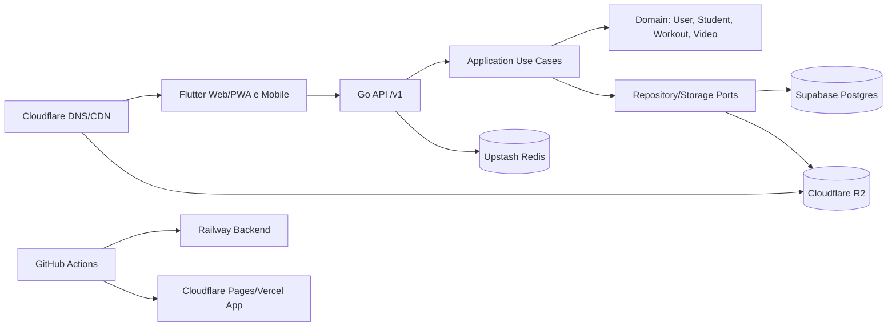
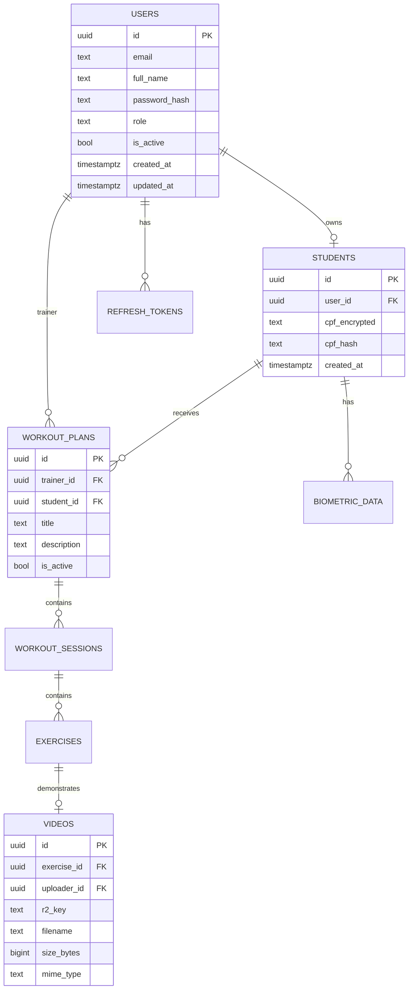
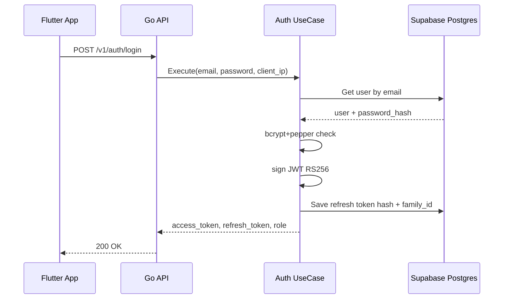
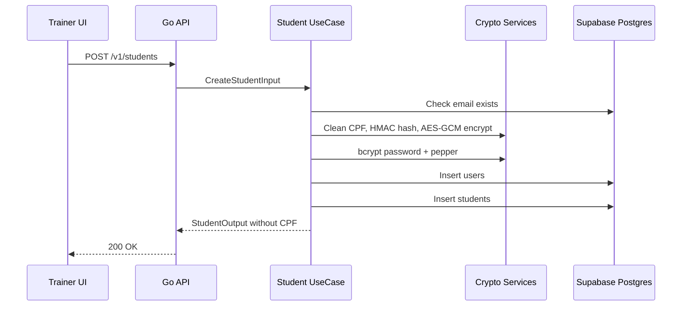
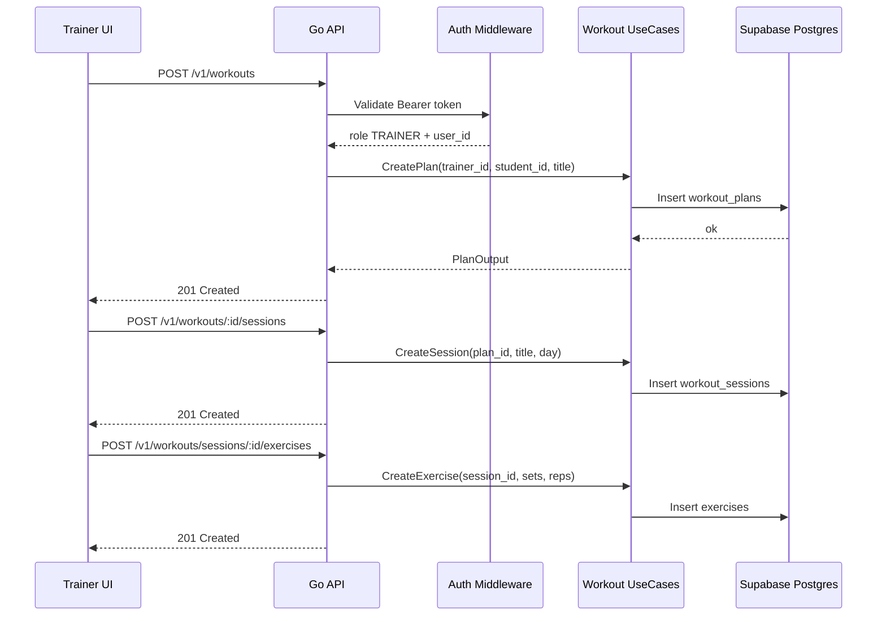
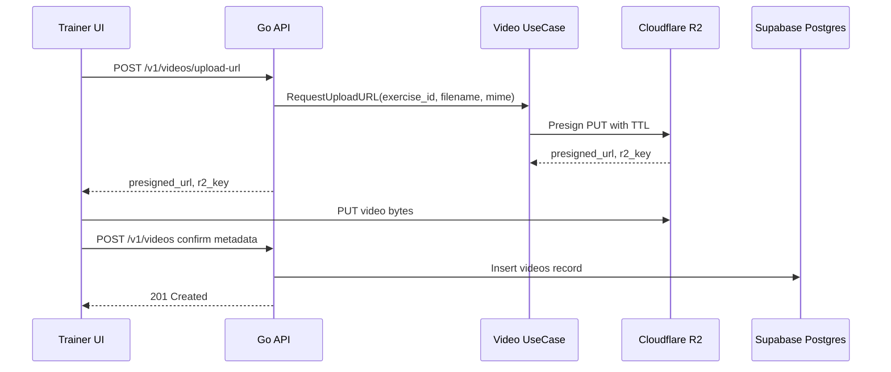
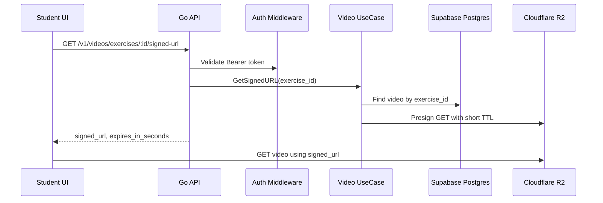
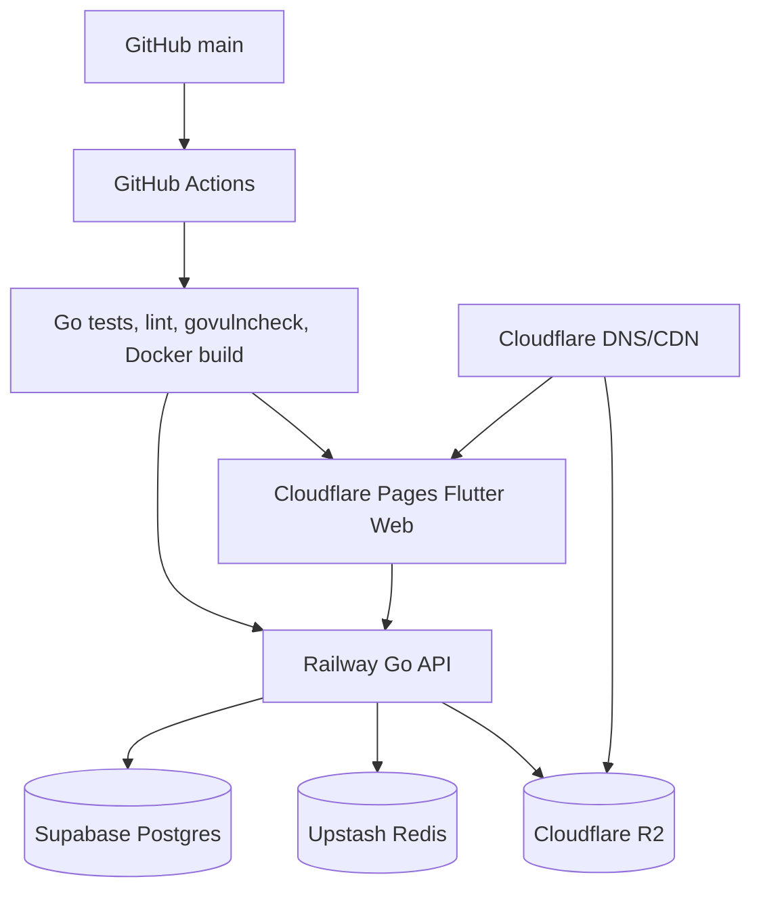

# Software Architecture Document (SAD)

## Fit Brother - Personal Fitness Platform

**Versao:** 2.0  
**Data:** 2026-09-13  
**Status:** Arquitetura alvo para MVP pessoal em free-tier

---

## 1. Objetivo

Fit Brother e uma plataforma pessoal para gestao de alunos, planos de treino,
sessoes, exercicios e videos demonstrativos. O produto deve comecar como
Flutter Web/PWA, evoluir para app Android/iOS com a mesma base Flutter e manter
backend proprio em Go.

Os objetivos arquiteturais sao:

- operar com custo zero ou proximo de zero usando free-tier;
- preservar dados sensiveis de alunos conforme LGPD;
- manter backend testavel via arquitetura hexagonal;
- servir videos com URL assinada e TTL curto;
- permitir evolucao visual inspirada em apps fitness modernos, sem copiar assets
  de terceiros.

---

## 2. Stack Alvo

| Camada | Decisao | Justificativa |
| --- | --- | --- |
| App | Flutter Web/PWA primeiro; Android/iOS depois | Reuso de UI, rotas e estado; ja existe no repositorio |
| Backend | Go 1.26.6 em CI/Docker, modulo Go 1.25.0 + Gin | Baixo custo, binario simples, codigo atual |
| Banco | Supabase PostgreSQL | PostgreSQL gerenciado free-tier usando `DATABASE_URL` |
| Banco local | PostgreSQL 16 via Docker Compose | Replica local simples da Supabase |
| Cache | Upstash Redis | Rate limit, sessoes auxiliares e cache curto |
| Storage | Cloudflare R2 | Storage S3-compatible, bom para videos |
| CDN/DNS | Cloudflare Free | Dominio, cache, protecao basica e proximidade com R2 |
| Backend deploy | Railway | Ja existe workflow de deploy no CI |
| App deploy | Cloudflare Pages recomendado; Vercel aceitavel | Free-tier e bom encaixe com Cloudflare |
| CI/CD | GitHub Actions | Lint, security scan, testes, build e deploy |

## 3. Modulos do Repositorio

```text
cmd/api                 API Go
internal/domain         Entidades e ports
internal/application    Use cases e DTOs
internal/adapters       HTTP, Postgres e R2
internal/infrastructure Config, crypto, JWT e logger
migrations              SQL versionado por golang-migrate
docker                  Dockerfile e Compose local
fit_brother_app         Flutter Web/mobile
docs                    Arquitetura e planos
```

O backend segue arquitetura hexagonal. O dominio nao depende de Gin, sqlx,
Supabase, Redis, R2 ou Railway. Integracoes externas ficam em adapters ou
infrastructure.



---

## 4. Requisitos Funcionais Cobertos

| RF | Requisito | Componentes |
| --- | --- | --- |
| RF-01 | Login, refresh e logout | `auth`, JWT RS256, refresh tokens |
| RF-02 | Cadastro e listagem de alunos | `student`, Postgres |
| RF-03 | Consulta e anonimizacao LGPD de aluno | `student`, crypto, Postgres |
| RF-04 | Criacao e consulta de planos de treino | `workout`, Postgres |
| RF-05 | Criacao de sessoes e exercicios | `workout`, Postgres |
| RF-06 | Upload de video demonstrativo | `video`, R2 signed upload URL |
| RF-07 | Playback seguro de video | `video`, R2 signed read URL |
| RF-08 | App responsivo com experiencia fitness | Flutter, Riverpod, GoRouter, Dio |
| RF-09 | Deploy free-tier | Railway, Supabase, Upstash, Cloudflare |

---

## 5. Persistencia e Migrations

O banco de producao deve ser Supabase PostgreSQL. O backend usa `DATABASE_URL`,
`pgx/v5`, `sqlx` e migrations SQL, entao nao depende de APIs proprietarias da
Supabase. O Compose local sobe PostgreSQL 16 e Redis 7 para desenvolvimento.

Migrations atuais:

- `001_create_users`
- `002_create_refresh_tokens`
- `003_create_students_and_biometrics`
- `004_create_workouts`
- `005_create_videos`

Comando de migracao:

```bash
go run ./scripts/migrate.go up
go run ./scripts/migrate.go down
```

### Modelo de Dados Atual



---

## 6. API HTTP

Base local: `http://localhost:8080/v1`

| Metodo | Rota | Acesso | Uso |
| --- | --- | --- | --- |
| GET | `/health` | Publico | Health check |
| POST | `/auth/login` | Publico | Login |
| POST | `/auth/refresh` | Publico | Refresh token |
| POST | `/auth/logout` | Publico hoje; deve exigir token/RT valido | Logout |
| POST | `/students` | Publico hoje; alvo TRAINER | Criar aluno |
| GET | `/students` | Autenticado | Listar alunos |
| GET | `/students/:id` | Autenticado | Detalhar aluno |
| DELETE | `/students/:id` | Autenticado | Anonimizacao |
| POST | `/workouts` | TRAINER | Criar plano |
| GET | `/workouts` | TRAINER/STUDENT | Listar planos por papel |
| GET | `/workouts/:id` | TRAINER/STUDENT dono | Detalhar plano |
| POST | `/workouts/:id/sessions` | TRAINER | Criar sessao |
| POST | `/workouts/sessions/:session_id/exercises` | TRAINER | Criar exercicio |
| POST | `/videos/upload-url` | TRAINER | Gerar URL assinada upload |
| POST | `/videos` | TRAINER | Confirmar upload |
| GET | `/videos/exercises/:exercise_id/signed-url` | Autenticado | Gerar URL assinada leitura |

Divida a evolucao de API em duas etapas:

1. estabilizar e documentar o contrato atual;
2. restringir `POST /students` e `POST /auth/logout` quando o fluxo do app ja
   tiver token e papel de treinador funcionando sem atrito.

---

## 7. Sequencias Principais

### 7.1 Login e Emissao de Tokens



### 7.2 Criacao de Aluno



### 7.3 Criacao de Plano, Sessao e Exercicio



### 7.4 Upload de Video



### 7.5 Playback de Video



---

## 8. Cache e Redis

Redis deve ser introduzido de forma incremental. Usos recomendados:

1. rate limit por IP/email em login e refresh;
2. bloqueio temporario de familias de refresh token comprometidas;
3. cache curto para listas nao sensiveis, como planos do usuario logado;
4. invalidacao por write: criar/editar plano, sessao, exercicio ou aluno.

Nao cachear CPF descriptografado, access tokens ou payloads com dados sensiveis.

---

## 9. Seguranca e LGPD

- CPF: AES-256-GCM com AAD baseado no `student_id`.
- Busca de CPF: HMAC-SHA256 com `CPF_HMAC_SECRET`.
- Senhas: bcrypt com `PASSWORD_PEPPER`.
- JWT: RS256 com chaves em `secrets` localmente e secrets no provider.
- Videos: R2 keys privadas; acesso via signed URLs com TTL curto.
- Anonimizacao: `DELETE /students/:id` deve remover dados identificaveis.
- Logs: nunca registrar CPF, senha, refresh token ou URL assinada completa.

Debito tecnico atual: remover logs verbosos de falha de login que exponham
hash de senha antes de qualquer ambiente compartilhado ou deploy publico.

---

## 10. Deploy e Ambientes

### Desenvolvimento local

- API: `go run ./cmd/api`
- Banco/Redis: `docker/docker-compose.yml`
- Migrations: `go run ./scripts/migrate.go up`
- App: `cd fit_brother_app && flutter run -d chrome`

### Producao alvo



Railway continua sendo o deploy do backend porque o workflow ja contem
`railway up --service fit-brother-api`. Cloudflare Pages e recomendado para o
Flutter Web por consolidar DNS/CDN/R2; Vercel segue viavel se for mais rapido
para o primeiro publish.

---

## 11. Direcao Visual do App

A referencia Dribbble escolhida aponta para:

- tema escuro, alto contraste e verde de acao;
- cards compactos para metricas, treinos e progresso;
- linguagem mobile-first;
- tracking de treino, metas e saude;
- espaco futuro para gamificacao e recomendacoes.

O app nao deve copiar layout, assets ou marca de terceiros. A direcao visual
sera reinterpretada em um design system proprio:

- cores: preto/carvao, cinza frio, verde energetico, branco;
- componentes: cards de treino, chips de status, barras de progresso, video
  preview, bottom navigation;
- telas prioritarias: login, dashboard, alunos, planos, detalhe do plano,
  criacao de sessao/exercicio e player de video.

---

## 12. Observabilidade

MVP:

- logs estruturados no backend com zerolog;
- request id por requisicao;
- logs de erro sem dados sensiveis;
- health check `/v1/health`;
- metricas simples no provider de deploy.

Evolucao:

- dashboard de erros por endpoint;
- alerta de taxa alta de login falho;
- alerta de erro em signed URLs;
- tracking de tamanho total no R2.

---

## 13. Riscos e Mitigacoes

| Risco | Impacto | Mitigacao |
| --- | --- | --- |
| Free-tier suspender ou hibernar servicos | App lento ou indisponivel | Aceitar para uso pessoal; documentar limites |
| Flutter Web gerar bundle grande | UX inicial ruim | Lazy loading, assets otimizados, PWA cache |
| URL assinada vazar | Acesso temporario ao video | TTL curto e R2 key privada |
| Cache servir dado sensivel | LGPD | Nao cachear CPF, tokens ou URLs completas |
| Contrato API mudar sem app acompanhar | Regressao | Testes de handler/usecase e plano de API |

---

## 14. Criterios de Aceite da Arquitetura

- Supabase e a base oficial de producao; Postgres local replica o contrato.
- Railway faz deploy do backend com Dockerfile atual.
- Flutter Web/PWA e o primeiro cliente publicado.
- R2 armazena videos; backend nunca faz proxy de arquivo grande.
- Redis e usado primeiro para rate limit, depois cache curto.
- Diagramas deste SAD representam fluxos implementaveis no codigo atual.
- Nenhuma decisao exige servico pago para o MVP pessoal.
